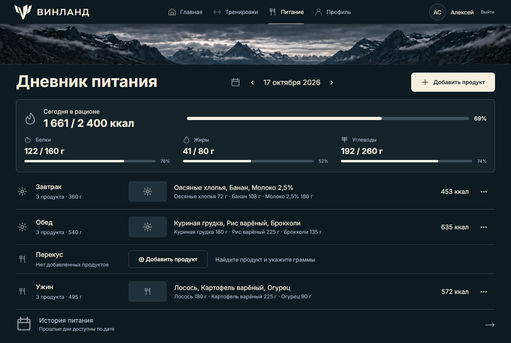
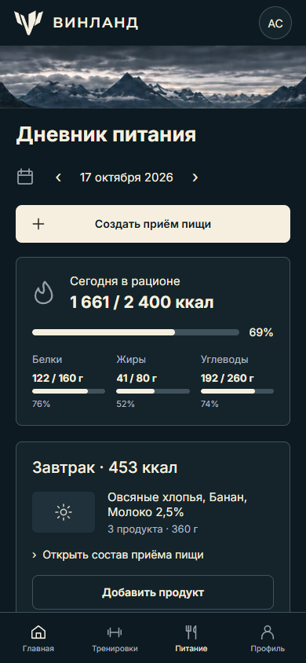
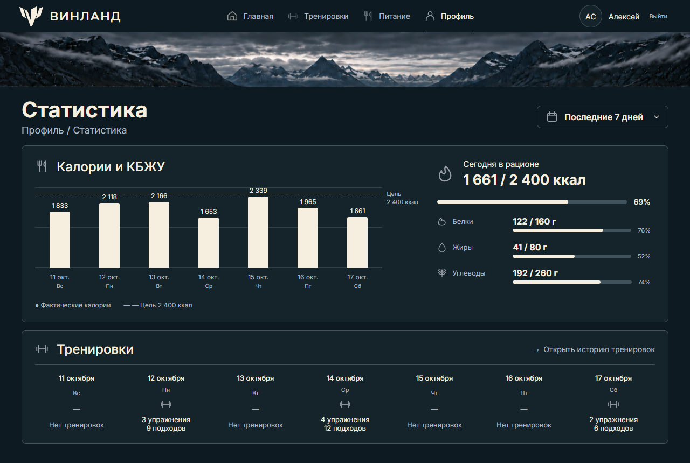
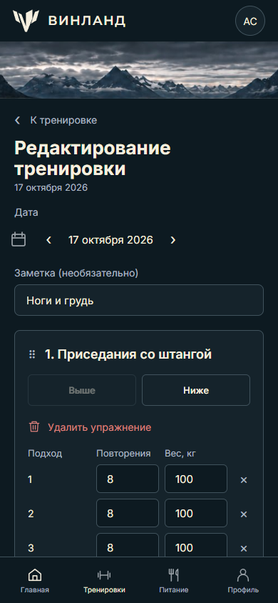
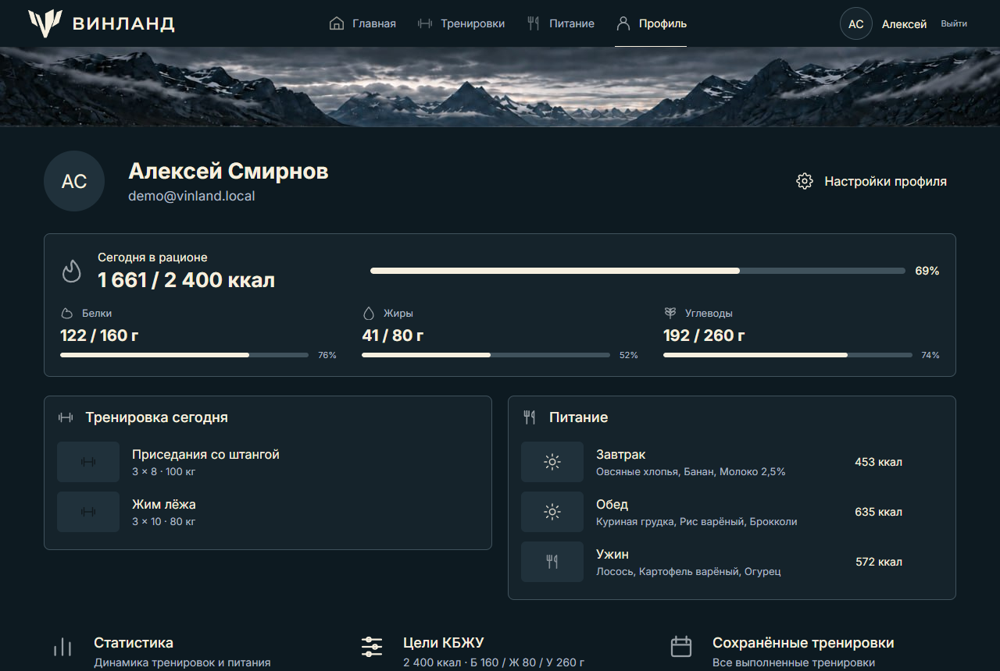
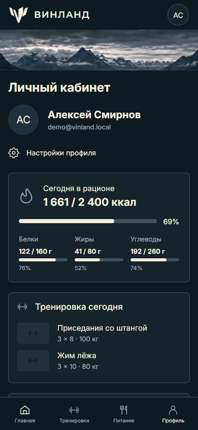

# ВИНЛАНД — дневник тренировок и питания

Веб-приложение для тех, кто занимается силовыми тренировками и считает КБЖУ.
Записываешь тренировку (упражнения, подходы, вес), ведёшь дневник питания по
граммовкам — и видишь, сколько съел относительно своих целей и как часто
тренируешься. Курсовой проект, сделанный по собственным макетам в Figma.

- [Путеводитель по коду](docs/CODE-GUIDE.md): где что лежит и путь одного запроса от кнопки до базы.
- [Выкладка в интернет](docs/DEPLOY.md): бесплатное демо на Render и Aiven (MySQL).

| Компьютер                                                  | Телефон                                                              |
| ---------------------------------------------------------- | -------------------------------------------------------------------- |
|  |  |
|      |     |
|     |     |

## Что умеет

- **Тренировки.** Упражнения из справочника, подходы с повторениями и весом,
  порядок упражнений, заметки к упражнению и к каждому подходу. Список по
  месяцам, просмотр, правка, удаление с подтверждением.
- **Питание.** Дневник по дням и приёмам пищи (завтрак, обед, перекус, ужин):
  находишь продукт, указываешь граммы — КБЖУ считается сам. История
  открывается на последнем дне с записями.
- **Цели и статистика.** Личные цели по калориям, белкам, жирам и углеводам;
  итоги дня с прогресс-барами; график калорий за 7/14/30 дней с линией цели и
  сводка тренировок по дням.
- **Администрирование.** Справочники упражнений и продуктов. Запись можно
  отключить: она исчезает из выбора, но старые тренировки и приёмы пищи с ней
  остаются как были.
- **Адаптивность.** Каждый экран свёрстан по трём макетам: компьютер (1280 px),
  планшет (834 px) и телефон (390 px), с нижней навигацией на телефоне.

## Стек и почему такой

| Слой      | Технологии                    | Зачем так                                                                                        |
| --------- | ----------------------------- | ------------------------------------------------------------------------------------------------ |
| Интерфейс | React 19, обычный CSS, Vite 7 | Без UI-библиотек: вся вёрстка своя, по макетам. Vite нужен только для сборки.                    |
| Сервер    | PHP 8.4 без фреймворка, PDO   | Хотелось самому написать маршрутизацию, валидацию, сессии и защиту, а не получить их из коробки. |
| База      | MySQL 8 (InnoDB, utf8mb4)     | Внешние ключи, `CHECK`-ограничения и транзакции держат данные целостными даже при ошибке в коде. |

`pnpm run build` собирает интерфейс в `public/ui/` (в Git сборка не хранится),
и дальше его отдаёт тот же PHP-сервер, что и API: отдельный Node-сервер в
работе не участвует.

## Как устроено

```
app/
├── public/          единственная папка, доступная из браузера
│   ├── index.php    точка входа: API-маршруты и выдача интерфейса по прямым адресам
│   ├── assets/      иконки и фотографии
│   └── ui/          собранный React (pnpm run build)
├── backend/         PHP-функции: auth, workouts, meals, statistics, admin,
│                    validation, http (JSON и CSRF), database (PDO)
├── database/        миграции 001–004, migrate.php, демо-данные и создание админа
├── src/
│   ├── pages/       экраны; у каждого переделанного экрана свой .css рядом
│   ├── components/  Layout, Shell, DaySummary, DateStepper, диалоги на <dialog>
│   ├── lib/         api (fetch + CSRF), router, даты, форматирование чисел и падежей
│   └── styles/      shared.css — общие блоки и брейкпоинты (≤900 планшет, ≤700 телефон)
└── tests/           unit-тесты PHP и HTTP-сценарии на Node
```

Путь запроса: браузер вызывает `fetch('/api/...')` через `src/lib/api.js`,
который добавляет CSRF-токен; `public/index.php` выбирает обработчик;
обработчик проверяет данные в `validation.php`, работает с базой через
подготовленные запросы PDO и отвечает JSON.

### Данные

Девять таблиц: `users`, `exercises`, `products`, `workouts`,
`workout_exercises`, `workout_sets`, `meals`, `meal_items`, `login_attempts`,
и служебная `migrations`, где `migrate.php` отмечает выполненные миграции.

Главное решение — **снимки в истории питания**. В `meal_items` хранятся не
только ссылка на продукт, но и его название и КБЖУ на 100 г на момент записи.
Если администратор потом исправит калорийность продукта или отключит его,
вчерашний дневник не изменится задним числом.

### Безопасность

- Пароли — `password_hash` (bcrypt), длина 10–72 байта.
- Сессия в cookie `HttpOnly` + `SameSite=Lax`, истекает после 30 минут
  бездействия или 24 часов; при входе идентификатор сессии меняется.
- Любой изменяющий запрос требует заголовок `X-CSRF-Token`.
- Ограничение перебора: 5 неверных паролей на аккаунт и 20 на IP за 15 минут.
- Роль не принимается от браузера: регистрация всегда создаёт обычного
  пользователя, администратора назначает только `create-admin.php` из консоли.
- Каждый запрос к тренировке или приёму пищи проверяет владельца.
- Тексты внутренних ошибок пишутся в журнал сервера, а не в ответ.

## Запуск локально

Нужны PHP 8.4+ с расширением `pdo_mysql`, MySQL 8 и, для сборки интерфейса,
Node.js 20.19+ с pnpm.

**Где взять MySQL на Windows** — подойдёт любой вариант:

- **MySQL Installer** (https://dev.mysql.com/downloads/installer/) →
  MySQL Server 8.4 и MySQL Shell или Workbench. При установке задаётся
  пароль пользователя `root`.
- **OpenServer** — включите модуль MySQL 8 в настройках.
- **XAMPP** — вместо MySQL там MariaDB; приложение работает и с ней
  (проверено на MariaDB 10.11). Пользователь `root` в XAMPP без пароля.

В `php.ini` должна быть включена строка `extension=pdo_mysql` (без `;` в
начале). Проверить: `php -m` выводит `pdo_mysql`.

```bash
# 1. База и пользователь для приложения (не root). Входим в консоль MySQL:
mysql -u root -p
```

```sql
CREATE DATABASE vinland CHARACTER SET utf8mb4;
-- Два адреса: PHP подключается к 127.0.0.1, а консоль mysql — к localhost.
CREATE USER 'vinland'@'localhost' IDENTIFIED BY 'придумайте-пароль';
CREATE USER 'vinland'@'127.0.0.1' IDENTIFIED BY 'придумайте-пароль';
GRANT ALL PRIVILEGES ON vinland.* TO 'vinland'@'localhost';
GRANT ALL PRIVILEGES ON vinland.* TO 'vinland'@'127.0.0.1';
EXIT;
```

```bash
# 2. Настройки: впишите пароль в DB_PASSWORD (остальное уже подходит)
cp .env.example .env

# 3. Таблицы, справочники и демо-аккаунт с тремя неделями данных
php database/migrate.php
php database/seed-demo.php

# 4. Сборка интерфейса в public/ui
pnpm install
pnpm run build

# 5. Сервер
php -S 127.0.0.1:8081 -t public router.php
```

Откройте http://127.0.0.1:8081 и войдите как `demo@vinland.local` /
`VinlandDemo2026`. Администратор создаётся командой
`php database/create-admin.php admin@example.com "пароль-от-10-символов"`.

Встроенный сервер PHP подходит только для разработки. В production нужны
HTTPS, `SESSION_SECURE=1` и веб-сервер с корнем строго в `app/public`.

## Проверки

Все проверки сразу, на временной базе, чтобы не трогать настоящие данные
(PowerShell, из папки `app`):

```powershell
$env:MYSQL_PWD = 'пароль root'   # нужен root: скрипт создаёт и удаляет базу
.\tests\run-http.ps1             # PHP-проверки и все HTTP-сценарии
.\tests\run-ui.ps1               # сквозной сценарий в браузере
```

Если `php` или `mysql` не в `PATH`, укажите пути:
`-PhpExe C:\php\php.exe -MysqlBin 'C:\Program Files\MySQL\MySQL Server 8.4\bin'`.
Другие параметры: `-MysqlUser`, `-DbPort`, `-KeepDatabase` (не удалять базу
после прогона, чтобы посмотреть данные).

`run-http.ps1` создаёт базу `vinland_test_ДАТА`, выполняет миграции и
запускает по очереди:

- `tests/unit.php` — валидация и расчёты, 16 проверок;
- `tests/meal-history.php` и `tests/workout-history.php` — история питания
  и тренировок прямо через PHP-функции;
- `tests/http.mjs` — сессия, cookie, CSRF, закрытые файлы;
- `tests/workouts.mjs`, `tests/meals.mjs`, `tests/admin-statistics.mjs` —
  тренировки, питание, админка и статистика; нужные им ID готовят
  `tests/seed-*.php`;
- `tests/auth.mjs` — регистрация, вход, выход, лимит попыток. Он идёт
  последним: после него вход с того же IP заблокирован на 15 минут.

Отдельную проверку можно запустить и вручную, когда сервер уже работает:

```bash
php tests/unit.php
TEST_API_URL=http://127.0.0.1:8081 node tests/http.mjs
```

**Сквозной сценарий в браузере** — `tests/ui.mjs` (Playwright, установленный
Chrome или Edge). Он проходит путь двух пользователей и администратора:
регистрация, цели КБЖУ, справочники, создание и правка тренировки и приёма
пищи, отключение записей справочника без изменения истории, ошибка
сохранения, чужие записи недоступны, истёкшая сессия, удаление с
подтверждением, отсутствие горизонтальной прокрутки на 834 и 390 px и ошибок
в консоли. Его запускает `tests/run-ui.ps1` (см. выше): создаёт отдельную
базу, накатывает миграции, поднимает сервер на порту 8090 и после прогона
удаляет базу.

## Что можно улучшить

- Подгружать шрифты локально, а не из Google Fonts.
- Пагинация для истории тренировок и для справочников, когда записей станет
  много.
